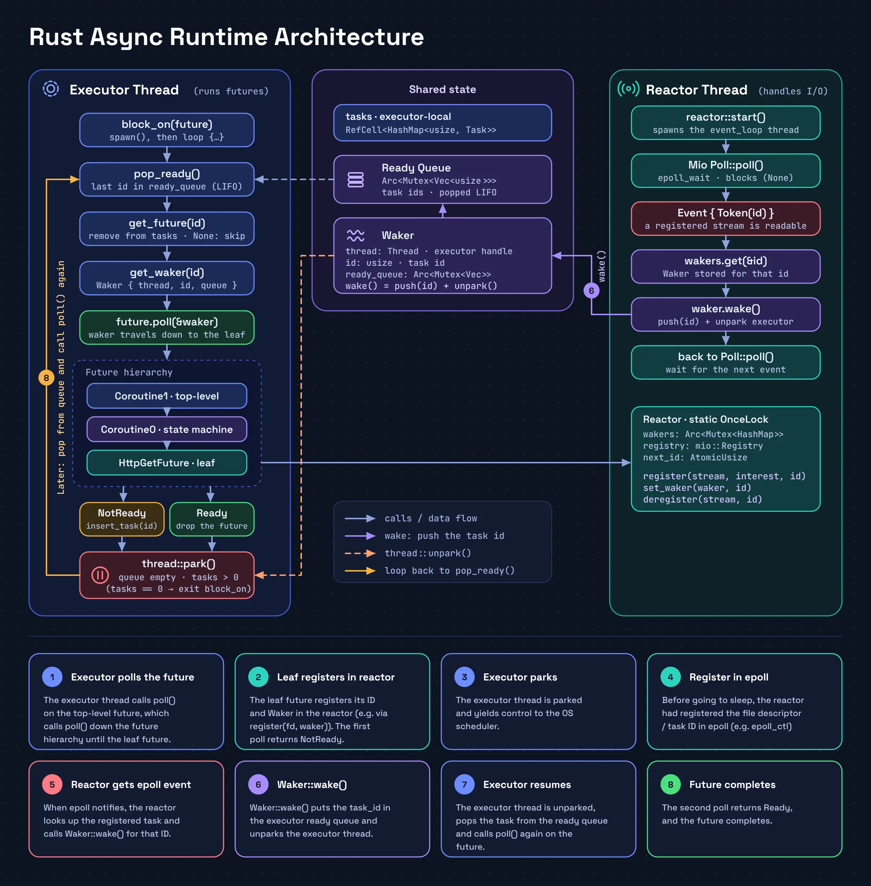
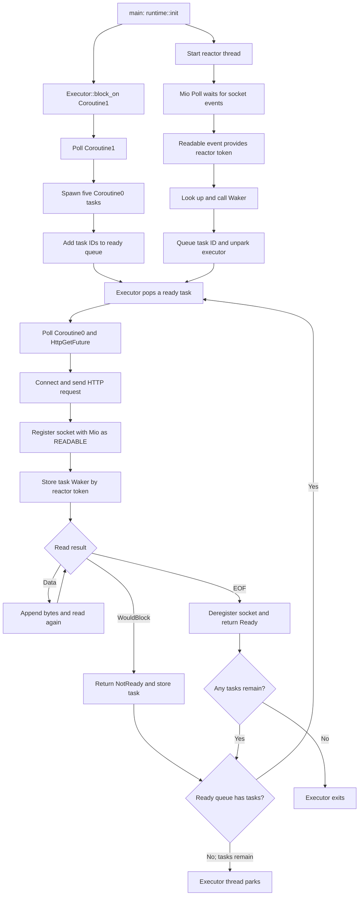

This workspace explores asynchronous I/O through four examples, each building
on ideas from the previous one:

- **`epoll`** calls Linux `epoll` APIs directly to monitor several nonblocking
   TCP streams. It demonstrates OS readiness notifications, but has no Future
   abstraction or task scheduler and is Linux-specific.
- **`coroutine`** represents requests as custom futures and advances them by
   repeatedly polling. This lets one request yield while its socket would block
   so others can make progress, but the busy-poll loop wastes CPU while all
   requests are waiting.
- **`runtime`** adds `Mio` polling so the thread can block until socket activity
   occurs instead of spinning. Its executor and reactor are coupled through a
   global registry, limiting the design to a single runtime context.
- **`reactor-executor`** separates task execution from the reactor and uses a
   `Waker` to requeue the task whose I/O became ready. It demonstrates waking
   tasks and multiple executors sharing a reactor.



- [epoll crate](#epoll-crate)
  - [How It Works](#how-it-works)
  - [Linux Syscalls](#linux-syscalls)
  - [Run the Example](#run-the-example)
  - [Platform](#platform)
- [coroutine crate](#coroutine-crate)
  - [Big Picture](#big-picture)
  - [Core Types and Responsibilities](#core-types-and-responsibilities)
    - [`future::Future` and `PollState`](#futurefuture-and-pollstate)
    - [`Coroutine0` (single request task)](#coroutine0-single-request-task)
    - [`HttpGetFuture` (non-blocking I/O future)](#httpgetfuture-non-blocking-io-future)
    - [`join_all` (fan-out + aggregate completion)](#join_all-fan-out--aggregate-completion)
    - [`Coroutine1` (top-level orchestrator)](#coroutine1-top-level-orchestrator)
  - [How the Polling Workflow Achieves Concurrency](#how-the-polling-workflow-achieves-concurrency)
  - [Mental Model: "Advance One Step Per Poll"](#mental-model-advance-one-step-per-poll)
  - [Running](#running)
  - [Notes and Limits](#notes-and-limits)
- [runtime crate](#runtime-crate)
  - [Big Picture](#big-picture-1)
  - [Runtime and Reactor](#runtime-and-reactor)
  - [HTTP Future and Scheduling](#http-future-and-scheduling)
  - [Running](#running-1)
- [reactor-executor](#reactor-executor)
  - [Overall Flow](#overall-flow)
  - [Executor and Task Scheduling](#executor-and-task-scheduling)
  - [How the Waker Works](#how-the-waker-works)
  - [How HTTP Futures Register with Mio](#how-http-futures-register-with-mio)
  - [Multiple Executors on Separate Threads, awaken by the same Reactor](#multiple-executors-on-separate-threads-awaken-by-the-same-reactor)
  - [Run the Example](#run-the-example-1)


# epoll crate

This workspace crate is a small Linux I/O polling example built directly on
the `epoll` system calls. It demonstrates waiting for readiness notifications
from multiple nonblocking TCP streams without assigning a thread to each
connection. It is an educational example, not a general-purpose async runtime.

## How It Works

- `ffi` declares the C interfaces for creating, controlling, waiting on, and
  closing an epoll instance. It also defines the event structure and the
  `EPOLLIN` and `EPOLLET` bitflags.
- `Poll` owns the epoll instance and waits for events. Its `poll` method accepts
  a timeout in milliseconds; `None` waits indefinitely.
- `Registry` adds a `TcpStream` to the poller. Each registration has a token,
  which is returned with notified events so the caller can identify the stream.
- The example opens five nonblocking connections to the workspace's
  `delayserver`, registers read readiness with edge-triggered notifications,
  and reads each response until the stream reaches EOF.

The registration API currently supports adding TCP streams with
`EPOLL_CTL_ADD`; it does not expose modification or removal operations.

## Linux Syscalls

The FFI layer declares these Linux C functions using Rust `i32` for the C `int`
arguments and return values:

| Syscall | Purpose | Parameters | Return value |
| --- | --- | --- | --- |
| `epoll_create(size: i32) -> i32` | Creates an epoll instance for monitoring file descriptors. | `size` must be positive. Modern Linux kernels ignore it. | The new epoll file descriptor, or `-1` on error with `errno` set. |
| `close(fd: i32) -> i32` | Closes a file descriptor and releases the associated resource. | `fd` is the file descriptor to close. | `0` on success, or `-1` on error with `errno` set. |
| `epoll_ctl(epfd: i32, op: i32, fd: i32, event: *mut Event) -> i32` | Adds, modifies, or removes a file descriptor from an epoll instance. | `epfd` is the epoll file descriptor; `op` selects the operation (`EPOLL_CTL_ADD` adds a descriptor); `fd` is the descriptor affected; `event` contains Event settings: interests in `EPOLLIN` and `EPOLLET` and `token` identifying the `fd` and is unused when removing a descriptor. | `0` on success, or `-1` on error with `errno` set. |
| `epoll_wait(epfd: i32, events: *mut Event, maxevents: i32, timeout: i32) -> i32` | Waits for readiness notifications from descriptors registered with an epoll instance. | `epfd` is the epoll file descriptor; `events` points to the output array; `maxevents` is its capacity; `timeout` is in milliseconds (`-1` waits indefinitely, `0` returns without waiting). | The number of ready events (possibly `0` on timeout), or `-1` on error with `errno` set. |

## Run the Example

The example expects the delay server to be listening on `localhost:8080`.
Start it in one terminal from the workspace root:

```sh
cargo run -p delayserver
```

Then, in another terminal from the workspace root, run the epoll example:

```sh
cargo run -p epoll
```

The server logs each request and waits for the delay encoded in its path before
responding. The client prints epoll notifications and the response data, then
exits after all five streams have reached EOF.

## Platform

This crate calls Linux `epoll` APIs directly and is intended for Linux targets.

# coroutine crate

This crate demonstrates a minimal async runtime pattern built from scratch:
- A custom `Future` trait (`poll` + `PollState`)
- Explicit state-machine coroutines
- Non-blocking HTTP I/O
- Cooperative concurrency via repeated polling

## Big Picture

`main` repeatedly polls a top-level future (`Coroutine1`) until it returns `Ready`.

Each call to `poll()` does a *small amount of work* and then returns:
- `PollState::NotReady` when more progress is needed later
- `PollState::Ready(T)` when the task is complete

That repeated polling loop is the scheduler in this example.

## Core Types and Responsibilities

### `future::Future` and `PollState`

In `src/future.rs`:
- `Future` defines `fn poll(&mut self) -> PollState<Self::Output>`
- `PollState::Ready(T)` means done
- `PollState::NotReady` means try again later

This contract is what allows many in-flight operations to make incremental progress.

### `Coroutine0` (single request task)

In `src/main.rs`, `Coroutine0` models one request with explicit states:
- `State0::Start(i)`
- `State0::Wait1(Box<dyn Future<Output = String>>)`
- `State0::Resolved`

Polling behavior:
1. `Start(i)` builds a path and creates `Http::get(path)` future.
2. State moves to `Wait1(...)`.
3. In `Wait1`, it polls the HTTP future.
4. If HTTP is `NotReady`, `Coroutine0` returns `NotReady`.
5. If HTTP is `Ready(response)`, it prints response, transitions to `Resolved`, and returns `Ready`.

So one `Coroutine0` poll either initializes work or advances/readies that one request.

### `HttpGetFuture` (non-blocking I/O future)

In `src/http.rs`, `Http::get` returns `HttpGetFuture`.

Its internal state is implicit in fields:
- `stream: Option<mio::net::TcpStream>`
- `buffer: Vec<u8>`
- `path: String`

Polling behavior:
1. First poll: connect, set non-blocking, write request, return `NotReady`.
2. Later polls: attempt `read` loop.
3. If read returns bytes, append to `buffer` and keep reading in same poll.
4. If read returns `WouldBlock`, return `NotReady` (socket not ready yet).
5. If read returns `0` (EOF), convert buffer to string and return `Ready(response)`.

This is the key non-blocking behavior: `WouldBlock` means "not done yet", not failure.

### `join_all` (fan-out + aggregate completion)

In `src/future.rs`, `join_all` stores `(finished, future)` pairs plus `finished_count`.

On each `poll()` call:
- Iterate all child futures.
- Skip already-finished ones.
- Poll unfinished ones once each.
- Mark each newly-ready future as finished.

Result:
- `Ready` only when all children are done.
- Otherwise `NotReady`.

This is where concurrency emerges: multiple request futures are advanced in a round-robin polling pass.

### `Coroutine1` (top-level orchestrator)

In `src/main.rs`, `Coroutine1` states:
- `State1::Start`
- `State1::Wait1(Box<dyn Future<Output = String>>)`
- `State1::Resolved`

Polling behavior:
1. `Start`: builds 5 `Coroutine0` request futures.
2. Wraps them in `join_all`.
3. Transitions to `Wait1`.
4. In `Wait1`, polls `join_all`.
5. Returns `Ready` once all 5 requests complete.

## How the Polling Workflow Achieves Concurrency

No thread pool is required here. Concurrency comes from repeatedly advancing many state machines:

1. `main` calls `Coroutine1.poll()` in a loop.
2. `Coroutine1` polls `join_all`.
3. `join_all` polls each `Coroutine0`.
4. Each `Coroutine0` polls its `HttpGetFuture`.
5. Any socket that is not ready returns `WouldBlock -> NotReady` quickly.
6. The loop moves on to other futures instead of blocking on one request.

So each iteration of the `for` loop inside `join_all.poll()` advances every unfinished future by one step. Over many outer loop iterations, all requests complete.

## Mental Model: "Advance One Step Per Poll"

Think of every future as a tiny state machine:
- It remembers where it left off (`state` fields and internal buffers).
- `poll()` advances it as far as possible *right now*.
- If it cannot continue without waiting on I/O, it yields `NotReady`.

That is exactly what "advance the state machine at each iteration" means in this crate.

## Running

The example expects the delay server to be listening on `localhost:8080`.
Start it in one terminal from the workspace root:

```sh
cargo run -p delayserver
```
From workspace root:

```bash
cargo run -p coroutine
```

Make sure the local HTTP server expected at `127.0.0.1:8080` is running.

## Notes and Limits

- This is educational runtime code, not production async.
- It uses busy polling in `main` (no event loop wakeups).
- `join_all` output is currently a placeholder `String`.
- Errors are mostly handled with `panic!`/`unwrap()` for simplicity.

# runtime crate

The `runtime` crate is the next step after `coroutine`: it keeps the custom
`Future`, `PollState`, and `join_all` model, but adds an operating-system-backed
reactor so the program does not have to busy-poll while sockets are waiting for
data. It uses Mio to provide the readiness polling abstraction.

## Big Picture

The program creates a top-level `Coroutine1` and passes it to
`Runtime::block_on`. The runtime repeatedly polls that future. When it returns
`NotReady`, the runtime waits for socket readiness; once Mio reports activity,
it polls the future tree again. The program completes when the top-level future
returns `Ready`.

Compared with the `coroutine` crate, the key change is what happens between
polls: `coroutine` immediately polls again, while `runtime` can block in the OS
reactor until an I/O event occurs.

## Runtime and Reactor

In `src/runtime.rs`, `Runtime` owns a Mio `Poll` instance. `Runtime::new`
creates the poller and stores a cloned Mio `Registry` in a process-wide
`OnceLock`. `block_on` runs the top-level future and, when it is not ready,
calls Mio's `poll` with no timeout. This parks the thread until registered I/O
is ready rather than spinning continuously.

The HTTP future accesses that shared registry to register its socket for
readability. This connects the executor (which polls futures) to the reactor
(which waits for I/O readiness).

## HTTP Future and Scheduling

In `src/http.rs`, `Http::get` creates an `HttpGetFuture`. On its first poll,
the future connects to `127.0.0.1:8080`, makes the socket nonblocking, sends an
HTTP request, and registers the socket for readable events. It then reads
available data until it reaches EOF or the socket returns `WouldBlock`.

`join_all` continues polling each unfinished request future. A future that
returns `NotReady` yields control to the others; when all requests are waiting,
`Runtime::block_on` waits in Mio. When I/O becomes ready, the runtime polls the
future tree again so the HTTP futures can continue reading.

## Running

The runtime example connects to the delay server at `127.0.0.1:8080`. Start the
server from the workspace root in one terminal:

```sh
cargo run -p delayserver
```

Then run the runtime example from the workspace root in another terminal:

```sh
cargo run -p runtime
```

The reactor registry is global, so the executor and reactor are coupled and only one runtime instance is supported in a process.

# reactor-executor

This workspace crate extends the `coroutine` and `runtime` examples with a
small task executor and a separate Mio-based reactor thread. The executor polls
ready futures; the reactor waits for socket readiness and uses each task's
`Waker` to schedule it again. This lets multiple HTTP request futures make
progress concurrently without repeatedly polling tasks that are waiting for
network input.

## Overall Flow

1. `runtime::init()` starts the reactor thread and creates an `Executor`.
2. `main` calls `Executor::block_on` with the top-level `Coroutine1` future.
3. The executor schedules `Coroutine1`. On its first poll, it spawns five
   `Coroutine0` request futures and completes.
4. Each request task is polled in turn. It creates an `HttpGetFuture`, which
   initiates its request and registers its socket with the reactor.
5. If a request has no data ready, its future returns `NotReady`. The executor
   stores that future but does not immediately queue it again, allowing other
   ready requests to run.
6. Once no tasks are ready, the executor parks its thread while pending tasks
   remain. The reactor thread continues waiting for Mio events.
7. When a socket becomes readable, the reactor wakes the task associated with
   that socket. The executor resumes, polls the task again, and the HTTP future
   reads available data.
8. When a response reaches EOF, its future deregisters the socket and returns
   `Ready`. The executor drops completed tasks and exits after all tasks have
   completed.



## Executor and Task Scheduling

The custom `Future` trait in `src/future.rs` has a `poll` method that receives
the task's `Waker` and returns either `PollState::Ready(value)` or
`PollState::NotReady`.

In `src/runtime/executor.rs`, `spawn` assigns each future a task ID, stores it
in a task map, and adds its ID to a shared ready queue. `Executor::block_on`
repeatedly removes ready IDs, takes their futures out of the map, and polls
them. A future that returns `NotReady` is put back in the task map, **but not the
ready queue; the reactor is responsible for queueing it again when its I/O is
ready**. A completed future is dropped.

The ready queue is a `Vec` popped from the end, so scheduling is LIFO. When the
queue is empty but tasks remain, the executor calls `thread::park()` instead of
busy-polling.

## How the Waker Works

For each task poll, the executor creates a `Waker` containing the task ID, a
handle to the executor thread, and a shared reference to the ready queue. The
reactor stores a clone of that waker under the corresponding reactor ID.

When Mio reports an event, the reactor reads the ID from the event's `Token`,
looks up its waker, and calls `wake()`. `Waker::wake` pushes the task ID onto
the ready queue and calls `Thread::unpark()` to resume the executor thread.
The executor then polls the task again. The leaf future refreshes the stored
waker when it still receives `WouldBlock`, ensuring the reactor holds the
latest waker for future readiness notifications.

## How HTTP Futures Register with Mio

`Http::get` creates an `HttpGetFuture`, the leaf future that owns the socket,
response buffer, request path, and unique reactor ID. During its first `poll`:

1. It connects to `127.0.0.1:8080`, makes the standard TCP stream nonblocking,
   converts it to `mio::net::TcpStream`, and writes the HTTP request.
2. It calls `reactor::register` with the stream, `Interest::READABLE`, and its
   unique ID. The reactor registers the stream with the `mio::Poll` registry
   using `Token(id)`.
3. It calls `reactor::set_waker` to associate this future's ID with the waker
   passed into `poll`.
4. It attempts to read. Available bytes are appended to its buffer; on
   `WouldBlock`, it refreshes the stored waker and returns `NotReady`.

The reactor's event loop blocks in `mio::Poll::poll`. A readable event contains
the token registered by the HTTP future, allowing the reactor to find and wake
the right task. On EOF, the future deregisters its stream and returns the
collected response.

## Multiple Executors on Separate Threads, awaken by the same Reactor

`fn parallel_executors` demonstrates running more than one executor
at the same time. Calls `runtime::init()` once on the main thread,
which starts the reactor, then runs one `Executor::block_on` on the main thread
and creates one additional thread with its own `Executor::new()` and
`block_on`. The loop `1..2` creates exactly one extra executor thread, so this
example runs two executors in total. Each executor runs its own `Coroutine1`,
which spawns five request tasks into that executor's task queue.

Both executors use the **same reactor**, not separate reactors. The reactor is
stored in a process-wide `OnceLock`, and `runtime::init()` is called only once.
Its Mio `Poll`, registry, event loop, and waker map are shared by both
executor threads. Each executor has separate thread-local task storage and a
ready queue, while each task's `Waker` records the thread that polled it. When
the shared reactor receives an event, it invokes that task's waker; the `Waker::wake`
method queues the task on its owning executor and unparks the thread where the executor runs. The
reactor's atomic ID generator gives sockets unique tokens across both executors.


## Run the Example

The example expects the workspace delay server at `127.0.0.1:8080`. Start the
server in one terminal from the workspace root:

```sh
cargo run -p delayserver
```

Then run this crate in another terminal from the workspace root:

```sh
cargo run -p reactor-executor
```

Future polling happens on the executor thread; the separate reactor thread waits for I/O events and wakes tasks.
