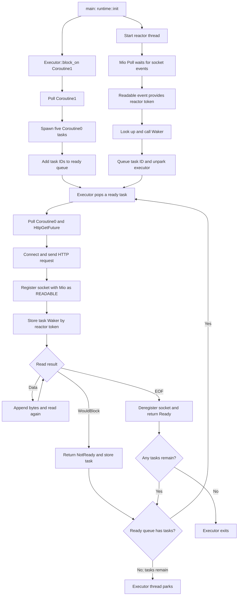

# reactor-executor

This workspace crate extends the `coroutine` and `runtime` examples with a
small task executor and a separate Mio-based reactor thread. The executor polls
ready futures; the reactor waits for socket readiness and uses each task's
`Waker` to schedule it again. This lets multiple HTTP request futures make
progress concurrently without repeatedly polling tasks that are waiting for
network input.

## Overall Flow

1. `runtime::init()` starts the reactor thread and creates an `Executor`.
2. `main` calls `Executor::block_on` with the top-level `Coroutine1` future.
3. The executor schedules `Coroutine1`. On its first poll, it spawns five
   `Coroutine0` request futures and completes.
4. Each request task is polled in turn. It creates an `HttpGetFuture`, which
   initiates its request and registers its socket with the reactor.
5. If a request has no data ready, its future returns `NotReady`. The executor
   stores that future but does not immediately queue it again, allowing other
   ready requests to run.
6. Once no tasks are ready, the executor parks its thread while pending tasks
   remain. The reactor thread continues waiting for Mio events.
7. When a socket becomes readable, the reactor wakes the task associated with
   that socket. The executor resumes, polls the task again, and the HTTP future
   reads available data.
8. When a response reaches EOF, its future deregisters the socket and returns
   `Ready`. The executor drops completed tasks and exits after all tasks have
   completed.



## Executor and Task Scheduling

The custom `Future` trait in `src/future.rs` has a `poll` method that receives
the task's `Waker` and returns either `PollState::Ready(value)` or
`PollState::NotReady`.

In `src/runtime/executor.rs`, `spawn` assigns each future a task ID, stores it
in a task map, and adds its ID to a shared ready queue. `Executor::block_on`
repeatedly removes ready IDs, takes their futures out of the map, and polls
them. A future that returns `NotReady` is put back in the task map, **but not the
ready queue; the reactor is responsible for queueing it again when its I/O is
ready**. A completed future is dropped.

The ready queue is a `Vec` popped from the end, so scheduling is LIFO. When the
queue is empty but tasks remain, the executor calls `thread::park()` instead of
busy-polling.

## How the Waker Works

For each task poll, the executor creates a `Waker` containing the task ID, a
handle to the executor thread, and a shared reference to the ready queue. The
reactor stores a clone of that waker under the corresponding reactor ID.

When Mio reports an event, the reactor reads the ID from the event's `Token`,
looks up its waker, and calls `wake()`. `Waker::wake` pushes the task ID onto
the ready queue and calls `Thread::unpark()` to resume the executor thread.
The executor then polls the task again. The leaf future refreshes the stored
waker when it still receives `WouldBlock`, ensuring the reactor holds the
latest waker for future readiness notifications.

## How HTTP Futures Register with Mio

`Http::get` creates an `HttpGetFuture`, the leaf future that owns the socket,
response buffer, request path, and unique reactor ID. During its first `poll`:

1. It connects to `127.0.0.1:8080`, makes the standard TCP stream nonblocking,
   converts it to `mio::net::TcpStream`, and writes the HTTP request.
2. It calls `reactor::register` with the stream, `Interest::READABLE`, and its
   unique ID. The reactor registers the stream with the `mio::Poll` registry
   using `Token(id)`.
3. It calls `reactor::set_waker` to associate this future's ID with the waker
   passed into `poll`.
4. It attempts to read. Available bytes are appended to its buffer; on
   `WouldBlock`, it refreshes the stored waker and returns `NotReady`.

The reactor's event loop blocks in `mio::Poll::poll`. A readable event contains
the token registered by the HTTP future, allowing the reactor to find and wake
the right task. On EOF, the future deregisters its stream and returns the
collected response.

## Run the Example

The example expects the workspace delay server at `127.0.0.1:8080`. Start the
server in one terminal from the workspace root:

```sh
cargo run -p delayserver
```

Then run this crate in another terminal from the workspace root:

```sh
cargo run -p reactor-executor
```

Future polling happens on the executor thread; the separate reactor thread waits for I/O events and wakes tasks.